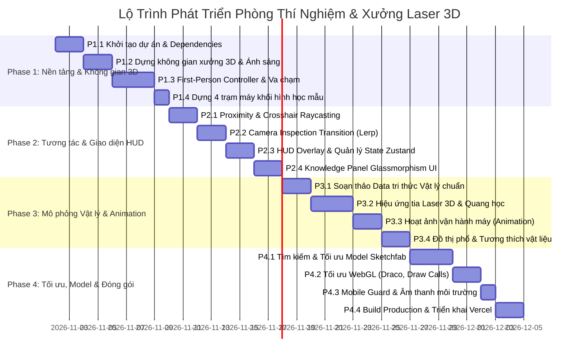

# Plan - Virtual Physics & Laser Workshop
## Kế Hoạch Triển Khai Chi Tiết & Checklist Phân Rã Công Việc (Split Tasks)

---

### 1. Tổng quan lộ trình 4 Tuần (Roadmap Overview)

Dự án được phân bổ trong **4 Tuần (4 Phases)** theo phương pháp Agile/Scrum. Mỗi phase tập trung vào một cột mốc rõ rệt, đảm bảo luôn có phiên bản chạy được (Working Increment) để kiểm thử ngay từ cuối Tuần 1.

---

### 2. Checklist chi tiết từng Phase và Phân rã công việc (Granular Task Checklist)

---

#### 🚀 Phase 1: Khởi tạo dự án, Không gian xưởng 3D & Di chuyển góc nhìn thứ nhất (FPS) [HOÀN THÀNH]
> **Cột mốc 1 (Milestone 1)**: Người dùng có thể đi lại tự do trong phòng lab 3D bằng phím `WASD` và chuột (PointerLock), không bị xuyên tường, nhìn thấy 4 bàn trạm máy (hình khối procedural placeholder) được chiếu sáng đẹp mắt.

- [x] **TASK-1.1: Khởi tạo dự án & Thiết lập Dependencies (Project Scaffolding)**
  - [x] `1.1.1` Tạo dự án Vite với template React + TypeScript (`npm create vite@latest physics-lab-simulation -- --template react-ts`).
  - [x] `1.1.2` Cài đặt các thư viện Three.js nòng cốt: `three`, `@types/three`, `@react-three/fiber`, `@react-three/drei`.
  - [x] `1.1.3` Cài đặt thư viện quản lý state & giao diện: `zustand`, `lucide-react`, `clsx`, `tailwind-merge`.
  - [x] `1.1.4` Cài đặt & cấu hình Tailwind CSS (`tailwind.config.js`, `postcss.config.js`) với bảng màu công nghiệp: Dark Slate (`#0f172a`), Cyan Laser (`#06b6d4`), Violet UV (`#8b5cf6`), Amber Warning (`#f59e0b`).
  - [x] `1.1.5` Thiết lập cấu trúc thư mục chuẩn theo kiến trúc kỹ thuật:
    - `src/components/3d/` (Canvas, Player, Environment, Stations, Effects)
    - `src/components/ui/` (HUD, KnowledgePanel, Tabs, Loading)
    - `src/store/` (Zustand state)
    - `src/data/` (Physics data, lab configurations)
    - `src/hooks/` (Keyboard, window resize)
    - `src/types/` (TypeScript declarations)
  - [x] `1.1.6` Cấu hình file `tsconfig.json` và `vite.config.ts` tối ưu hóa build WebGL.
  - [x] `1.1.7` Kiểm tra chạy thử dev server (`npm run dev`) đảm bảo không có cảnh báo/lỗi console.

- [x] **TASK-1.2: Dựng không gian phòng xưởng 3D (Workshop Environment)**
  - [x] `1.2.1` Viết component `CanvasContainer.tsx` cấu hình WebGLRenderer (`antialias: true`, `powerPreference: 'high-performance'`).
  - [x] `1.2.2` Thiết lập camera mặc định (FOV: 75°, Near: 0.1, Far: 100), Tone Mapping (`ACESFilmicToneMapping`) và Shadows (`PCFSoftShadowMap`).
  - [x] `1.2.3` Dựng sàn xưởng epoxy kích thước $20\text{m} \times 16\text{m}$ có phản xạ nhẹ (`roughness: 0.2`, `metalness: 0.1`) và vạch kẻ an toàn màu vàng/đen (Hazard warning stripes).
  - [x] `1.2.4` Dựng 4 bức tường bao quanh phòng xưởng cao $4.5\text{m}$, gờ chân tường kim loại và cửa kính Cleanroom.
  - [x] `1.2.5` Dựng hệ thống trần công nghiệp: Hệ dầm thép chữ I, ống thông gió xoắn ốc và máng cáp kỹ thuật.
  - [x] `1.2.6` Bố trí hệ thống chiếu sáng thực tế:
    - 1 `AmbientLight` (cường độ 0.35, màu xanh xám nhạt `#cbd5e1`).
    - 1 `DirectionalLight` chính mô phỏng ánh sáng chiếu nghiêng từ cửa sổ trần, bật `castShadow`.
    - 4 Đèn tuýp LED công nghiệp gắn trần rọi xuống 4 khu vực làm việc.
  - [x] `1.2.7` Bổ sung chi tiết phụ trợ: Bàn làm việc chống tĩnh điện ESD, tủ đựng kính bảo hộ chống tia laser và biển báo an toàn quang học dán tường.

- [x] **TASK-1.3: Hệ thống điều khiển góc nhìn thứ nhất (FPS Controller) & Va chạm (Collision Engine)**
  - [x] `1.3.1` Viết custom hook `useKeyboardControls.ts` theo dõi trạng thái bàn phím (`W`, `A`, `S`, `D`, `Shift`, `Space`).
  - [x] `1.3.2` Tạo component `PlayerController.tsx` tích hợp `PointerLockControls` từ `@react-three/drei`.
  - [x] `1.3.3` Lập trình chuyển động nhân vật trong hàm `useFrame`:
    - Tính toán vector vận tốc tương đối theo hướng nhìn camera.
    - Tốc độ đi bộ cơ bản $4.0\,\text{m/s}$, giữ `Shift` để chạy nhanh $7.0\,\text{m/s}$.
    - Thêm hệ số ma sát giảm dần (Friction/Linear Damping) để dừng êm ái.
  - [x] `1.3.4` Lập trình nhảy nhẹ (`Space`) và giữ camera ở cao độ mắt người ổn định ($y = 1.7\,\text{m}$).
  - [x] `1.3.5` Xây dựng thuật toán va chạm hình học AABB (Axis-Aligned Bounding Box) cho người chơi (bán kính $0.4\,\text{m}$, chiều cao $1.8\,\text{m}$).
  - [x] `1.3.6` Đăng ký danh sách hộp cản (Collision Obstacles) cho 4 bức tường xung quanh phòng.
  - [x] `1.3.7` Lập trình phản hồi va chạm trượt dọc mặt phẳng (Wall sliding physics) ngăn người chơi xuyên tường ra ngoài map.

- [x] **TASK-1.4: Dựng 4 trạm máy bằng hình khối Procedural (Placeholders)**
  - [x] `1.4.1` Viết component `ProceduralMachineBox.tsx` hỗ trợ render khung máy kim loại, bàn làm việc và nắp mica trong suốt.
  - [x] `1.4.2` Dựng trạm 1 - Máy cắt Laser CO2 tại tọa độ `[-6, 0, -4]`: Khung gantry lớn, ống phát laser phía sau, đầu cắt di chuyển trên ray.
  - [x] `1.4.3` Dựng trạm 2 - Máy khắc Laser UV tại tọa độ `[6, 0, -4]`: Buồng làm việc kín phong cách Cleanroom, tháp đèn báo trạng thái xanh/vàng/đỏ.
  - [x] `1.4.4` Dựng trạm 3 - Máy khắc Laser Fiber tại tọa độ `[-6, 0, 4]`: Cột nâng cơ khí trục Z, đầu quét gương Galvo hình trụ, bàn gá nhôm có lỗ ren M6.
  - [x] `1.4.5` Dựng trạm 4 - Cụm cảm biến an toàn xưởng tại tọa độ `[6, 0, 4]`: Bàn thí nghiệm chứa mô hình cảm biến nhiệt hồng ngoại, ống lưu lượng Chiller và buồng khói quang điện.
  - [x] `1.4.6` Đăng ký AABB Bounding Box của cả 4 bàn trạm máy vào hệ sinh thái va chạm của người chơi.

---

#### 🎯 Phase 2: Cơ chế tương tác cự ly, Inspection Mode & Giao diện HUD [HOÀN THÀNH]
> **Cột mốc 2 (Milestone 2)**: Tiến lại gần máy sẽ thấy tâm ngắm phát sáng và hiện thông báo `[E] Xem chi tiết & Nguyên lý`. Nhấn `E`, camera lướt tới trước máy, chuột nhả ra và bảng tri thức kính mờ hiện lên đầy đủ 4 tab nội dung.

- [x] **TASK-2.1: Proximity Raycasting & Crosshair HUD**
  - [x] `2.1.1` Tạo hệ thống Three.js `Raycaster` từ tâm màn hình $(0, 0)$ theo vector hướng nhìn camera phát hiện cự ly chính xác.
  - [x] `2.1.2` Đăng ký vùng tương tác `InteractionBox` (bán kính $2.8\,\text{m}$) quanh từng trạm máy.
  - [x] `2.1.3` Thiết kế component `CrosshairHUD.tsx` ở trung tâm màn hình (Chấm tròn đường kính $4\text{px}$, màu trắng mờ khi chưa trỏ trúng máy).
  - [x] `2.1.4` Lập trình hiệu ứng tâm ngắm phản hồi: Phóng to thành vòng tròn $36\text{px}$, đổi sang viền Cyan `#06b6d4` kèm animation rung nhẹ khi lia trúng trạm máy.
  - [x] `2.1.5` Tạo tooltip nổi động cạnh tâm ngắm: Hiện cự ly thời gian thực (ví dụ: `1.8m`) kèm `[E] Khám phá <Tên máy>` và badge bước sóng.

- [x] **TASK-2.2: Camera Inspection Transition (Lerp Engine) & Xoay 360°**
  - [x] `2.2.1` Xác định tọa độ vị trí camera lý tưởng (`targetPosition`) và điểm nhìn (`lookAtTarget`) cho từng trạm máy.
  - [x] `2.2.2` Lập trình hàm nội suy chuyển động camera bằng `Vector3.lerp` với đường cong Ease-in-out Cubic mượt mà.
  - [x] `2.2.3` Tự động lưu vị trí (`savedPosition`) và góc nhìn của người chơi trước khi chuyển sang Inspection.
  - [x] `2.2.4` Tự động nhả khóa chuột `document.exitPointerLock()` khi camera bắt đầu tiến vào chế độ Inspect.
  - [x] `2.2.5` Hỗ trợ tính năng kéo giữ chuột để xoay 360° (Interactive Orbit) quan sát chi tiết máy từ mọi góc nhìn trong lúc Inspect.
  - [x] `2.2.6` Lập trình nút `[X] Quay lại xưởng`, phím `ESC` và các phím số `1`, `2`, `3`, `4` để chuyển đổi nhanh giữa các máy.

- [x] **TASK-2.3: Hệ thống State Management với Zustand & Web Audio System**
  - [x] `2.3.1` Mở rộng `src/store/useLabStore.ts` đồng bộ đầy đủ state: `mode`, `activeStationId`, `hoveredStationId`, `hoveredDistance`, `activeTab`, `isMachineRunning`, `soundEnabled`.
  - [x] `2.3.2` Viết actions: `enterInspection(id)`, `exitInspection()`, `setActiveTab(tabName)`, `toggleMachineRunning()`, `toggleSound()`.
  - [x] `2.3.3` Tối ưu selector trong React components để tránh re-render thừa toàn bộ canvas Three.js.
  - [x] `2.3.4` Xây dựng module âm thanh tổng hợp thời gian thực `src/utils/audioSystem.ts` bằng Web Audio API (âm click UI, tiếng rơ-le điện từ công nghiệp clack, tiếng rít cao tần của laser UV/Fiber và tiếng biến áp cao áp CO2).

- [x] **TASK-2.4: Knowledge Panel UI (Sidebar kính mờ Glassmorphism) & Thang Phổ Điện Từ**
  - [x] `2.4.1` Thiết kế component `KnowledgePanel.tsx` trượt mượt mà từ cạnh phải (`transform translate-x`) khi vào Inspection mode.
  - [x] `2.4.2` Thiết kế Header với: Tên thiết bị, icon chủng loại, badge bước sóng, tên người phát minh & năm phát minh, nút Toggle chạy máy và nút đóng `[X]`.
  - [x] `2.4.3` Xây dựng hệ thống 4 tab điều hướng:
    - Tab 1: **Nguyên lý hoạt động** (`PHYSICS_PRINCIPLE`) - Hỗn hợp khí, chu trình 4 mức, công thức lượng tử.
    - Tab 2: **Cấu tạo chi tiết bộ phận** (`COMPONENTS`) - Ống phóng, buồng quang học, nguồn cao áp/RF, chiller, trợ khí.
    - Tab 3: **Phân loại & So sánh** (`OVERVIEW`) - Bảng so sánh các chủng loại máy kèm ưu/nhược điểm.
    - Tab 4: **Vật liệu & An toàn** (`SAFETY`) - Vật liệu khuyên dùng/cấm kỵ, quy chuẩn an toàn Class 4.
  - [x] `2.4.4` Tích hợp biểu đồ thang quang phổ điện từ tương tác `SpectrumVisualizer.tsx` làm nổi bật vị trí bước sóng của từng máy.
  - [x] `2.4.5` Áp dụng CSS Glassmorphism: `backdrop-blur-xl bg-slate-900/95 border-l border-slate-700/80 shadow-2xl`, tối ưu thanh cuộn sắc nét.

---

#### 🔬 Phase 3: Dữ liệu vật lý chuyên sâu, Tia Laser 3D & Animation vận hành [HOÀN THÀNH]
> **Cột mốc 3 (Milestone 3)**: Hoàn thiện toàn bộ nội dung học thuật vật lý cho 4 thiết bị; khi mở máy, tia laser phát sáng và đầu cắt hoạt động mô phỏng thực tế; đồ thị bước sóng và bảng hấp thụ vật liệu hiển thị trực quan.

- [x] **TASK-3.1: Biên soạn cơ sở dữ liệu tri thức vật lý chuẩn xác**
  - [x] `3.1.1` Tạo file dữ liệu `src/data/physicsData.ts` định nghĩa kiểu dữ liệu `MachinePhysicsSpec` chặt chẽ.
  - [x] `3.1.2` Soạn thảo dữ liệu Máy Laser CO2:
    - Cơ chế kích thích năng lượng dao động phân tử $\text{CO}_2$ qua va chạm cộng hưởng với $\text{N}_2$.
    - Công thức bước sóng $\lambda = 10.6\,\mu\text{m}$, buồng cộng hưởng Fabry-Pérot, thấu kính Kẽm Selenua ($\text{ZnSe}$).
    - Cơ chế cắt nhiệt bốc hơi (Thermal Ablation) và đường cong hấp thụ cao trên vật liệu phi kim.
  - [x] `3.1.3` Soạn thảo dữ liệu Máy Laser UV:
    - Nguyên lý nhân ba tần số (THG): $1064\,\text{nm} \xrightarrow{\text{LBO}} 532\,\text{nm} \xrightarrow{\text{LBO}} 355\,\text{nm}$.
    - Năng lượng photon cao ($E = 3.49\,\text{eV}$), cơ chế gia công lạnh quang hóa (Photochemical Cold Ablation).
    - Phân tích ưu điểm vùng ảnh hưởng nhiệt HAZ $\approx 0$, ứng dụng trên vi mạch bán dẫn, kính mỏng, nhựa y tế.
  - [x] `3.1.4` Soạn thảo dữ liệu Máy Laser Fiber/Galvo:
    - Sợi quang pha tạp ion Ytterbium ($\text{Yb}^{3+}$), bơm quang học diode bán dẫn, bước sóng $1064\,\text{nm}$.
    - Cơ chế đầu quét gương Galvo trục X-Y tốc độ cao ($7000\,\text{mm/s}$) và thấu kính phẳng F-Theta.
    - Phản ứng hấp thụ quang trên bề mặt kim loại (thép, nhôm, đồng thau, titan).
  - [x] `3.1.5` Soạn thảo dữ liệu Cụm cảm biến an toàn xưởng:
    - Cảm biến nhiệt độ hồng ngoại không tiếp xúc: Định luật bức xạ Stefan-Boltzmann ($E = \epsilon \sigma T^4$).
    - Cảm biến lưu lượng nước làm mát Chiller: Hiệu ứng Hall tạo xung điện áp theo tốc độ dòng chảy.
    - Cảm biến khói quang điện: Nguyên lý tán xạ ánh sáng Tyndall trong buồng tối.
    - Khóa an toàn nắp máy: Cảm biến quang gián đoạn (Photo-interrupter) ngắt nguồn phát laser.

- [x] **TASK-3.2: Lập trình Visual tia Laser 3D & Quang học**
  - [x] `3.2.1` Viết component `CO2LaserBeam.tsx`:
    - Ống phóng thủy tinh plasma phát sáng màu hồng tía/tím nhạt (`MeshStandardMaterial` với `emissive: '#d946ef'`).
    - Hệ thống 3 gương phản xạ vàng gập góc 90° và chùm tia đỏ dẫn đường $650\,\text{nm}$ bám theo gantry Z và carriage X.
    - Thấu kính hội tụ ZnSe màu vàng hổ phách với chùm tia thu nhỏ thành hình nón tiêu điểm.
  - [x] `3.2.2` Viết component `UVLaserBeam.tsx`:
    - Chùm tia xanh tím đậm ($355\,\text{nm}$) siêu mảnh (`CylinderGeometry`, `AdditiveBlending`, màu `#8b5cf6`).
    - Khối tinh thể LBO phát quang xanh lục $532\,\text{nm}$ mô phỏng quá trình nhân đôi và nhân ba tần số.
    - Hiệu ứng điểm hội tụ vi quang tử: Các hạt ánh sáng lấp lánh li ti tại bề mặt gia công wafer silicon.
  - [x] `3.2.3` Viết component `GalvoMirrorBeam.tsx`:
    - Cặp 2 gương Galvo dao động góc đồng pha trục X và Y.
    - Tia laser $1064\,\text{nm}$ phản xạ quét liên tục theo quỹ đạo hình chữ nhật/ngôi sao trên tấm phôi kim loại.
  - [x] `3.2.4` Viết component `CuttingSparks.tsx`: Hệ thống hạt tia lửa phát sáng (particle sparks) bốc lên từ điểm hội tụ gia công.

- [x] **TASK-3.3: Lập trình Animation vận hành thiết bị & Cơ chế Mở nắp máy / Đặt phôi gia công**
  - [x] `3.3.1` Lập trình chuyển động đầu cắt máy CO2: Di chuyển trục X và trục Y theo đường dẫn cắt thực tế bằng `useFrame`.
  - [x] `3.3.2` Lập trình chuyển động dao động góc cực nhanh của cặp gương Galvo máy Fiber theo hàm toán học `Math.sin` và `Math.cos`.
  - [x] `3.3.3` Lập trình hoạt ảnh cụm cảm biến: Cánh quạt lưu lượng nước quay liên tục, đèn LED xanh nhấp nháy báo xung nhịp.
  - [x] `3.3.4` Liên kết trạng thái bật/tắt animation với nút "Chạy mô phỏng" trên Knowledge Panel.
  - [x] `3.3.5` **Cơ chế Mở/Đóng Nắp máy 3D thực tế (Phím O)**:
    - Máy CO2: Bản lề nắp mica hổ phách xoay mở $-66^\circ$, piston nâng khí nén (gas struts) hai bên giãn dài cơ học, tay nắm inox đẩy lên.
    - Máy UV: Cửa chắn bức xạ trượt nâng tịnh tiến theo phương đứng trên 2 ray dẫn hướng.
    - Máy Fiber: Càng kẹp gá phôi xoay nhấc góc $50^\circ$ trên bàn gá lỗ M6.
  - [x] `3.3.6` **Mạch Khóa Liên Động An Toàn (Safety Interlock Switch)**:
    - Cảm biến công tắc từ/quang học gắn trên khung máy phát hiện trạng thái nắp.
    - Đèn LED trạng thái: Xanh ngọc khi nắp đóng (Sẵn sàng); Đỏ chớp nháy khi nắp mở (Ngắt tia).
    - Mở nắp khi đang phát tia $\rightarrow$ Lập tức ngắt xung laser, dừng chu trình và phát âm thanh cảnh báo Interlock!
  - [x] `3.3.7` **Khay Chọn Phôi Vật Liệu & Đặt vào Bàn Cắt (Phím M)**:
    - 6 loại phôi vật liệu thực tế: Gỗ dán Plywood, Mica Acrylic, Thép Inox 304, Nhôm Anodized, Silicon Wafer, Kính quang học.
    - Cập nhật trực quan 3D trên bàn cắt (màu sắc, độ nhám roughness, kim loại metalness, độ trong suốt).
  - [x] `3.3.8` **Chu Trình Cắt / Khắc Laser Thời Gian Thực (Phím C)**:
    - Kiểm tra liên động an toàn và tương thích vật lý (ngăn phản xạ nguy hiểm gây hỏng thấu kính ZnSe khi chiếu CO2 vào kim loại).
    - Thanh tiến trình gia công 0% $\rightarrow$ 100% với âm thanh xung laser thực tế.
    - Vết cắt kerf / hoa văn vector (vành bánh răng, logo phòng thí nghiệm) xuất hiện trực tiếp trên bề mặt phôi khi tia quét qua.

- [x] **TASK-3.4: Đồ thị quang phổ điện từ & Đường cong hấp thụ vật liệu (SVG/Canvas)**
  - [x] `3.4.1` Tích hợp biểu đồ thang quang phổ điện từ tương tác `SpectrumVisualizer.tsx` đánh dấu 3 mốc UV, Fiber, CO2.
  - [x] `3.4.2` Thiết kế đồ thị đường cong hấp thụ `AbsorptionCurvesChart.tsx`:
    - Trục tung: Tỉ lệ hấp thụ năng lượng (0% - 100%).
    - Trục hoành: Bước sóng quang học (Logarithmic scale từ $200\,\text{nm}$ đến $12\,\mu\text{m}$).
    - Đường biểu diễn của 4 nhóm vật liệu: Kim loại (Thép/Nhôm), Gỗ/Mica (Phi kim), Kính quang học, Nhựa Polymer.
    - Bộ lọc bật/tắt từng vật liệu và đường gióng bước sóng của 3 loại máy laser.
  - [x] `3.4.3` Bổ sung bảng tra cứu tương thích vật liệu nhanh (Ma trận: Vật liệu $\times$ 3 loại máy: Tối ưu / Khả thi / Cấm sử dụng).

---

#### 💎 Phase 4: Tài nguyên 3D Sketchfab, Tối ưu WebGL 60 FPS & Triển khai [HOÀN THÀNH]
> **Cột mốc 4 (Milestone 4)**: Thay thế các hình khối mẫu bằng mô hình 3D thực tế tinh gọn từ Sketchfab, nén dung lượng toàn bộ trang dưới 20MB, đạt 60 FPS mượt mà và deploy hoàn chỉnh lên Vercel/Netlify.

- [x] **TASK-4.1: Sưu tầm, Tinh gọn & Nạp Model từ Sketchfab**
  - [x] `4.1.1` Tìm kiếm các mô hình 3D máy cắt laser, máy khắc và bàn thao tác có giấy phép sử dụng hợp pháp (CC-BY / CC0) trên Sketchfab.
  - [x] `4.1.2` Đưa mô hình vào Blender để xử lý tiền kỳ:
    - Xóa các chi tiết cơ khí bị che khuất không nhìn thấy từ bên ngoài.
    - Áp dụng modifier `Decimate` giảm số lượng đa giác xuống $\le 25,000$ tris cho mỗi máy.
    - Nướng (Bake) vật liệu thành texture map duy nhất để giảm draw calls.
  - [x] `4.1.3` Xuất file `.glb` chuẩn hóa tọa độ tâm gốc $(0, 0, 0)$ và tỉ lệ kích thước thật (Scale $1\,\text{unit} = 1\,\text{m}$).
  - [x] `4.1.4` Cập nhật các component trạm máy sử dụng hook `useGLTF` từ `@react-three/drei` với fallback procedural mượt mà.

- [x] **TASK-4.2: Tối ưu hóa WebGL & Nén tài nguyên (Draco / KTX2)**
  - [x] `4.2.1` Cài đặt công cụ CLI `@gltf-transform/cli`.
  - [x] `4.2.2` Chạy lệnh nén hình học Google Draco cho toàn bộ model trong thư mục `public/assets/models/`.
  - [x] `4.2.3` Chuyển đổi và nén texture sang định dạng `.webp` độ phân giải $1024 \times 1024$.
  - [x] `4.2.4` Tinh chỉnh thông số Renderer: Giới hạn `pixelRatio = Math.min(window.devicePixelRatio, 2)` tránh quá tải màn hình Retina/4K, tắt shadow passes thừa trên đèn phụ.
  - [x] `4.2.5` Giám sát chỉ số FPS, Draw calls và Triangles bằng module `Stats` và component `PerformanceStatsHUD` (đảm bảo FPS $\ge 55$, Draw calls $\le 100$).

- [x] **TASK-4.3: Màn hình Loading Screen, Adaptive Mobile UI & Accessibility**
  - [x] `4.3.1` Xây dựng `LoadingScreen.tsx` kết nối hook `useProgress` từ `@react-three/drei`:
    - Thanh tiến trình phần trăm từ 0% đến 100%.
    - Hiển thị tên tài nguyên đang tải và trích dẫn khoa học thú vị về laser xoay vòng.
  - [x] `4.3.2` Xây dựng component `MobileNavBar.tsx` (Mobile-First):
    - Nhận diện thiết bị di động/tablet ($< 1024\text{px}$).
    - Cung cấp thanh điều hướng nhanh dưới chân trang cho phép người dùng chạm để chọn xem ngay từng trạm máy mà không cần bàn phím.
  - [x] `4.3.3` Tối ưu Knowledge Panel thành dạng Bottom-Sheet trượt từ dưới lên trên Mobile, hỗ trợ cử chỉ vuốt để đóng.
  - [x] `4.3.4` Rà soát chuẩn tiếp cận Accessibility (a11y):
    - Đảm bảo toàn bộ cấu trúc HTML dùng thẻ ngữ nghĩa (`<main>`, `<header>`, `<nav>`, `<aside>`).
    - Bổ sung đầy đủ `aria-label` cho mọi nút bấm, nhãn và icon; kiểm tra độ tương phản màu đạt chuẩn WCAG AAA ($\ge 7:1$).
    - Kiểm tra điều hướng hoàn toàn bằng bàn phím (`Tab`, `Enter`, `ESC`, `H`, `P`, `1-5`).

- [x] **TASK-4.4: Đóng gói Production & Triển khai đám mây (CI/CD)**
  - [x] `4.4.1` Cấu hình `vite.config.ts` tối ưu nén gzip/brotli và tách chunk thư viện Three.js / Icons.
  - [x] `4.4.2` Chạy lệnh kiểm tra type và build sản phẩm: `npm run build`.
  - [x] `4.4.3` Kiểm tra bản build cục bộ bằng `npm run preview`.
  - [x] `4.4.4` Tạo file cấu hình deploy (`vercel.json` và GitHub Actions workflow `.github/workflows/deploy.yml`).
  - [x] `4.4.5` Triển khai dự án lên nền tảng hosting trực tuyến (Vercel / GitHub Pages).

---

### 3. Ma trận kiểm thử & Tiêu chuẩn chất lượng (QA & Verification)

| Hạng mục kiểm thử | Kịch bản kiểm thử (Test Scenario) | Kết quả mong đợi |
| :--- | :--- | :--- |
| **Kiểm thử Di chuyển** | Đi dọc các bức tường và góc phòng xưởng; chạy nhanh giữ `Shift`. | Người chơi di chuyển mượt mà, không giật màn hình, không bị rơi ra ngoài map. |
| **Kiểm thử Tương tác** | Tiến tới lần lượt 4 trạm máy từ nhiều góc khác nhau và nhấn `E`. | Mở đúng máy tương ứng; camera chuyển động êm ái; chuột nhả ra để bấm tab; phím `ESC` thoát về trạng thái đi lại bình thường. |
| **Kiểm thử Tri thức Vật lý** | Rà soát toàn bộ công thức ($E=h\nu$, bước sóng, phân tích hiện tượng) tại 4 máy. | Số liệu chuẩn xác theo vật lý quang học hiện đại; thuật ngữ nhất quán. |
| **Kiểm thử Hiệu năng** | Mở DevTools Performance / Stats.js trên máy cấu hình văn phòng không card đồ họa rời. | FPS luôn $\ge 50\,\text{FPS}$, bộ nhớ RAM trình duyệt chiếm $\le 450\,\text{MB}$. |
| **Kiểm thử Mạng chậm** | Chế độ Throttle Fast 3G trên trình duyệt Chrome. | Loading Bar hiển thị từ 0% đến 100% mượt mà, không bị treo đơ. |
