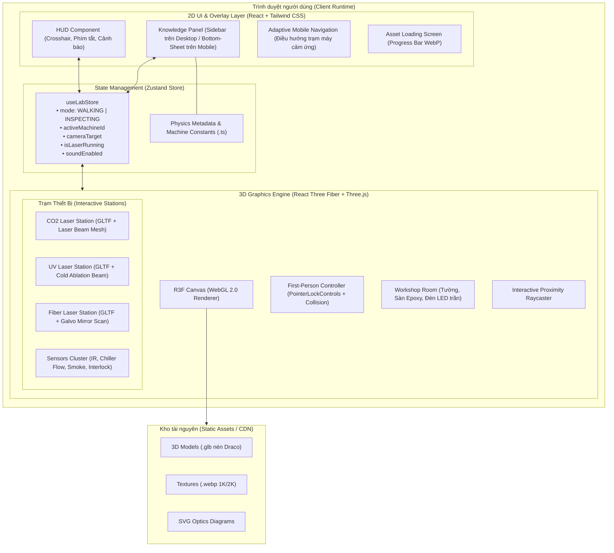
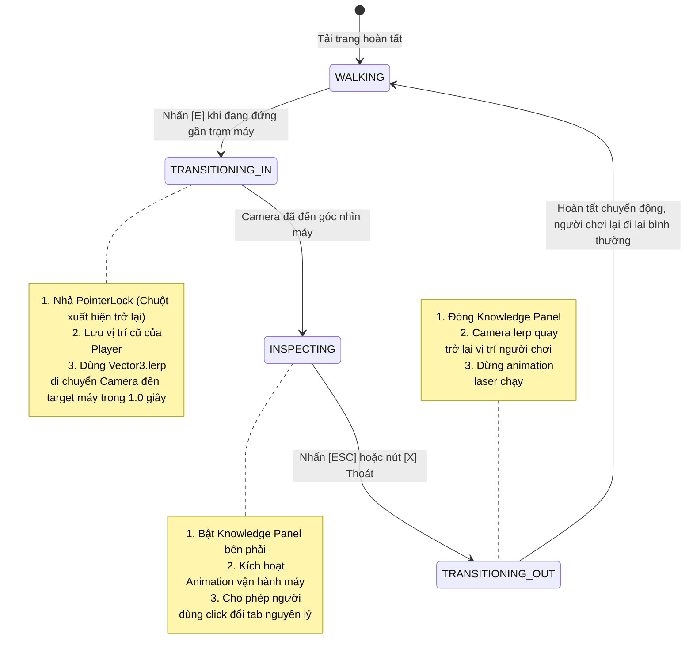

# Tech Architecture - Virtual Physics & Laser Workshop
## Kiến Trúc Kỹ Thuật Ứng Dụng Mô Phỏng Xưởng Laser 3D

---

### 1. Tổng quan kiến trúc hệ thống (System Overview)

Dự án được xây dựng dưới dạng **Client-Side Single Page Application (SPA)** hiện đại, chạy hoàn toàn trên trình duyệt người dùng mà không cần backend xử lý logic 3D hay cơ sở dữ liệu nặng. 

Kiến trúc phân tầng được chia thành 3 lớp rõ ràng:
1. **Lớp hiển thị 3D (3D Presentation Layer)**: Sử dụng **React Three Fiber (R3F)** và **Three.js** quản lý Scene Graph, ánh sáng thời gian thực, đổ bóng, hiệu ứng laser quang học và hệ thống camera góc nhìn thứ nhất.
2. **Lớp giao diện người dùng (2D Overlay & UI Layer)**: Xây dựng bằng **React**, **Tailwind CSS** và **Lucide React**, hiển thị HUD tâm ngắm, thông báo phím tắt và Knowledge Panel trượt thông tin nguyên lý.
3. **Lớp quản lý trạng thái & Dữ liệu (State & Data Layer)**: Sử dụng **Zustand** quản lý trạng thái toàn cục (vị trí người chơi, chế độ xem, máy đang chọn) và kho dữ liệu tĩnh TypeScript lưu trữ kiến thức vật lý, thông số quang học.



---

### 2. Bảng công nghệ chi tiết (Tech Stack & Libraries)

| Thành phần | Công nghệ lựa chọn | Phiên bản | Lý do kỹ thuật |
| :--- | :--- | :--- | :--- |
| **Core Framework** | React + TypeScript | React 19 / TS 5.x | Quản lý vòng đời component chặt chẽ, type safety cho dữ liệu vật lý quang học. |
| **Build Tool** | Vite | ^6.x | Tốc độ Hot Module Replacement (HMR) tức thì, build bundle siêu nhẹ cho ứng dụng 3D. |
| **3D Rendering** | Three.js | ^0.170.x | Thư viện đồ họa WebGL tiêu chuẩn công nghiệp mạnh mẽ nhất trên web. |
| **Three.js React Wrapper** | `@react-three/fiber` | ^8.x / ^9.x | Cú pháp khai báo lồng ghép (declarative) thân thiện với React, tự động dispose tài nguyên WebGL chống tràn bộ nhớ. |
| **3D Helper Suite** | `@react-three/drei` | ^9.x | Cung cấp sẵn các module tối ưu: `PointerLockControls`, `useGLTF`, `Billboard`, `Html`, `Text`, `Center`. |
| **State Management** | Zustand | ^5.x | Quản lý state cực nhẹ (< 1KB), không gây re-render thừa cho canvas 3D khi cập nhật vị trí camera hay trạng thái máy. |
| **Styling & UI** | Tailwind CSS | ^3.4.x | Thiết kế giao diện Glassmorphism hiện đại, responsive, tuỳ biến nhanh chóng. |
| **Icons & Visuals** | Lucide React | ^0.460.x | Bộ icon SVG sắc nét cho các công cụ vật lý, cảnh báo laser, thông số cảm biến. |
| **Asset Optimization** | gltf-transform + Draco | CLI | Tự động nén kích thước file 3D GLB từ 50MB xuống dưới 5MB. |

---

### 3. Thiết kế Scene Graph 3D (Three.js Hierarchy)

Cấu trúc hình học cây (Hierarchy) trong Scene 3D được phân tầng rõ rệt để tối ưu hóa render và tính toán va chạm:

```
Canvas (WebGLRenderer, Shadows enabled, ACESFilmicToneMapping)
 ├── PerspectiveCamera (FOV: 75°, Near: 0.1, Far: 100)
 ├── Lighting Environment
 │    ├── AmbientLight (Cường độ nhẹ: 0.4, màu xanh xám #e2e8f0)
 │    ├── DirectionalLight (Ánh sáng chính mô phỏng giếng trời/đèn xưởng, cast shadow)
 │    └── PointLight / SpotLights (Chiếu điểm tại từng bàn làm việc của 4 trạm máy)
 ├── Physics & Interaction
 │    ├── PlayerRig (Vị trí người chơi [x, y, z], gắn kèm PointerLockControls)
 │    │    └── AudioListener (Âm thanh môi trường và tiếng rơ-le máy)
 │    └── CollisionSystem (Tập hợp các AABB Bounding Boxes của tường và bàn máy)
 ├── Environment Meshes
 │    ├── FloorMesh (Sàn bê tông/epoxy công nghiệp, độ nhám roughness: 0.2, metalness: 0.1)
 │    ├── WallMeshes (Tường xưởng sơn trắng/xám công nghiệp, chống người đi xuyên)
 │    └── Ceiling & CableTrays (Hệ thống máng cáp, quạt thông gió trần mô phỏng)
 └── Workstations Group (Các trạm máy tương tác)
      ├── Workstation_CO2 (Vị trí: [-6, 0, -4])
      │    ├── Model_CO2Laser (GLTF nén hoặc Procedural Fallback Mesh)
      │    ├── LaserTube_GlassGlow (Hiệu ứng ống thủy tinh phát sáng hồng ngoại/hồng tía)
      │    └── LaserBeamCutter (CylinderMesh màu đỏ/hồng ngoại, đầu cắt di động)
      ├── Workstation_UV (Vị trí: [6, 0, -4])
      │    ├── Model_UVLaser (GLTF nén hoặc Procedural Fallback Mesh)
      │    └── UVBeamAblation (Chùm tia 355nm màu xanh tím siêu mảnh, điểm hội tụ lấp lánh)
      ├── Workstation_Fiber (Vị trí: [-6, 0, 4])
      │    ├── Model_FiberGalvo (Tháp máy khắc Galvo, cột nâng Z)
      │    └── GalvoScanEffect (Tia laser 1064nm quét đa giác tốc độ cao trên tấm nhôm)
      └── Workstation_Sensors (Vị trí: [6, 0, 4])
           ├── Model_SensorBench (Bàn kiểm tra cảm biến)
           ├── Sensor_IR_Thermopile (Mô hình đầu đọc nhiệt độ không tiếp xúc)
           ├── Sensor_Chiller_Flow (Mô hình ống dòng chảy có cánh quạt trong suốt)
           └── Sensor_Optical_Smoke (Mô hình hộp cảm biến khói có đèn LED nháy trạng thái)
```

---

### 4. Hệ thống điều khiển góc nhìn thứ nhất & Xử lý va chạm (FPS & Kinematics)

#### 4.1. Cơ chế di chuyển (Movement Kinematics)
Trong hàm vòng lặp khung hình `useFrame((state, delta) => ...)`:
- Nhận input từ bàn phím (`keydown`/`keyup`): `keys.forward`, `keys.backward`, `keys.left`, `keys.right`, `keys.sprint`.
- Tính toán vector vận tốc mong muốn (Target Velocity Vector) tương đối theo hướng nhìn hiện tại của camera:
  $$\vec{v}_{\text{forward}} = \vec{d}_{\text{camera}} \times (K_w - K_s)$$
  $$\vec{v}_{\text{right}} = (\vec{d}_{\text{camera}} \times \vec{up}) \times (K_d - K_a)$$
- Tốc độ cơ bản: $4.0\,\text{m/s}$; Khi giữ `Shift` (Sprint): $7.0\,\text{m/s}$.
- Áp dụng hệ số suy giảm ma sát (Damping / Friction) để chuyển động dừng mượt mà, không giật khựng.

#### 4.2. Xử lý va chạm hình học (AABB Collision Detection)
- Nhân vật được bọc trong một hình trụ hoặc hộp va chạm ảo (Player Bounding Box: Bán kính $0.4\,\text{m}$, Chiều cao $1.8\,\text{m}$).
- Toàn bộ tường bao phòng lab và các khối bàn máy lớn được đăng ký vào danh sách `ObstacleColliders`.
- Trước khi cộng vector vận tốc vào tọa độ camera, hàm kiểm tra va chạm sẽ chiếu trước vị trí tiếp theo ($P_{\text{next}} = P_{\text{current}} + \vec{v} \cdot \Delta t$).
- Nếu xảy ra chồng lấn (Intersection), vận tốc theo trục pháp tuyến của bề mặt va chạm bị triệt tiêu về 0, cho phép người chơi "trượt" dọc theo tường một cách tự nhiên.

#### 4.3. Phát hiện tương tác trạm máy (Proximity & Crosshair Raycasting)
- Từ tâm màn hình (Tọa độ Normalized Device Coordinates: $(0, 0)$), một tia `Raycaster` được bắn theo hướng nhìn của camera với khoảng cách tối đa $2.8\,\text{m}$.
- Mỗi trạm máy có một vùng tương tác `InteractionTriggerMesh`.
- Khi tia va chạm với trạm máy:
  - Cập nhật state `hoveredStationId = 'CO2_LASER'`.
  - Tâm ngắm crosshair trên HUD chuyển từ chấm tròn nhỏ sang vòng tròn kích thước lớn hơn kèm viền màu Cyan `#06b6d4`.
  - Hiển thị pop-up tooltip: `Nhấn [E] để xem chi tiết`.

---

### 5. Máy trạng thái chuyển đổi góc nhìn (Camera & Inspection State Machine)

Khi người dùng nhấn phím `E` tại một trạm máy, hệ thống kích hoạt chuỗi chuyển đổi trạng thái (State Transition):



---

### 6. Mô phỏng hiệu ứng quang học & Tia Laser (Laser Optics Simulation)

Để tái hiện chân thực nguyên lý vật lý mà vẫn đảm bảo 60 FPS mượt mà:
1. **Tia Laser CO2 ($10.6\,\mu\text{m}$)**:
   - Trong thực tế, tia laser $10.6\,\mu\text{m}$ là vô hình với mắt người. Tuy nhiên trong các máy công nghiệp, người ta luôn tích hợp một diode laser đỏ ($650\,\text{nm}$) dẫn đường (Red Guide Beam) đồng trục với tia CO2.
   - Ứng dụng mô phỏng: Thể hiện chùm tia màu đỏ tươi bán trong suốt (Cylinder Mesh với `AdditiveBlending`, opacity: 0.8), cùng với ống phóng thủy tinh phía sau máy phát ánh sáng plasma tím hồng (mô phỏng hỗn hợp khí $\text{CO}_2-\text{N}_2-\text{He}$ bị kích thích phóng điện cao áp).
2. **Tia Laser UV ($355\,\text{nm}$)**:
   - Mô phỏng bằng chùm tia siêu mảnh màu xanh tím thẫm (Deep Violet `#7c3aed`), tiêu điểm hội tụ cực nhỏ kèm các hạt vi quang tử (Point light xung nhịp nhanh) mô phỏng quá trình bẻ gãy liên kết phân tử lạnh.
3. **Tia Laser Fiber ($1064\,\text{nm}$)**:
   - Mô phỏng 2 gương Galvo xoay nhanh trên trục $X-Y$ bằng toán học dao động điều hòa (`Math.sin`, `Math.cos`), tạo ra đường quét hình chữ nhật hoặc logo mẫu liên tục trên bề mặt phôi kim loại.

---

### 7. Quy trình tối ưu hóa tài nguyên 3D (Asset Pipeline)

Để đảm bảo dung lượng tải về $< 20\,\text{MB}$ và chạy mượt trên mọi máy tính văn phòng:

```
[Sketchfab / 3D Sources] (.FBX / .OBJ / High-Poly .GLTF, 50-100MB)
       │
       ▼
[Blender 4.x - Tiền xử lý]
  ├── Decimate Modifier: Giảm số đa giác xuống < 30,000 tris / máy
  ├── Xóa bỏ các chi tiết thừa không nhìn thấy từ bên ngoài
  └── Gộp vật liệu (Material Baking) & gộp các sub-meshes để giảm Draw Calls
       │
       ▼
[gltf-transform / Draco CLI]
  ├── Nén hình học: gltf-transform draco input.glb output.glb --method edgebreaker
  └── Nén Texture sang WebP / KTX2: Độ phân giải tối đa 1024x1024 hoặc 2048x2048
       │
       ▼
[Production Assets: public/models/]
  ├── workshop_room.glb (~ 6 MB)
  ├── co2_laser_machine.glb (~ 3.5 MB)
  ├── uv_laser_machine.glb (~ 2.8 MB)
  ├── fiber_laser_machine.glb (~ 2.5 MB)
  └── sensors_station.glb (~ 1.8 MB)
       │ (Fallback Mode)
       ▼
[Procedural Three.js Geometries]
  └── Tự động dựng bằng BoxGeometry / CylinderGeometry nếu file GLB chưa tải xong!
```

---

### 8. Thiết kế Store quản lý trạng thái (Zustand State Architecture)

File quản lý trạng thái tập trung `src/store/useLabStore.ts`:

```typescript
export type AppMode = 'WALKING' | 'TRANSITIONING' | 'INSPECTING';
export type MachineId = 'CO2_LASER' | 'UV_LASER' | 'FIBER_LASER' | 'SENSOR_STATION';
export type InfoTab = 'OVERVIEW' | 'PHYSICS_PRINCIPLE' | 'SPECTRUM_MATERIALS' | 'SAFETY';

interface LabState {
  // Navigation & Game State
  mode: AppMode;
  hoveredStationId: MachineId | null;
  activeStationId: MachineId | null;
  
  // Camera & Transform Saved State
  previousPlayerPosition: [number, number, number];
  previousPlayerRotation: [number, number];
  
  // UI & Knowledge Panel State
  activeTab: InfoTab;
  isAudioEnabled: boolean;
  isMachineAnimated: boolean;
  
  // Actions
  setHoveredStation: (id: MachineId | null) => void;
  enterInspection: (id: MachineId) => void;
  exitInspection: () => void;
  setActiveTab: (tab: InfoTab) => void;
  toggleMachineAnimation: () => void;
  toggleAudio: () => void;
}
```

---

### 9. Cấu trúc thư mục mã nguồn dự án (Project Directory Layout)

```
physics-lab-simulation/
├── public/
│   ├── assets/
│   │   ├── models/                # Các file 3D .glb đã nén Draco
│   │   │   ├── workshop_room.glb
│   │   │   ├── co2_laser.glb
│   │   │   ├── uv_laser.glb
│   │   │   ├── fiber_galvo.glb
│   │   │   └── sensors_bench.glb
│   │   └── textures/              # Texture sàn epoxy, kim loại xước
│   └── favicon.ico
├── src/
│   ├── components/
│   │   ├── 3d/                    # Toàn bộ component Three.js / R3F
│   │   │   ├── CanvasContainer.tsx   # Canvas bao ngoài, cấu hình renderer, camera
│   │   │   ├── PlayerController.tsx  # Điều khiển góc nhìn thứ nhất (WASD + PointerLock)
│   │   │   ├── WorkshopEnvironment.tsx# Phòng lab, sàn, tường, đèn trần
│   │   │   ├── CollisionBounds.tsx   # Hệ thống hộp cản va chạm
│   │   │   ├── stations/             # Các trạm máy tương tác
│   │   │   │   ├── CO2LaserStation.tsx
│   │   │   │   ├── UVLaserStation.tsx
│   │   │   │   ├── FiberLaserStation.tsx
│   │   │   │   └── SensorStation.tsx
│   │   │   ├── visual-effects/       # Hiệu ứng tia laser & hạt quang học
│   │   │   │   ├── CO2LaserBeam.tsx
│   │   │   │   ├── UVLaserBeam.tsx
│   │   │   │   └── GalvoMirrorBeam.tsx
│   │   │   └── fallbacks/            # Hình khối dự phòng khi chưa tải xong GLB
│   │   │       └── ProceduralMachineBox.tsx
│   │   └── ui/                    # Toàn bộ giao diện 2D HTML/Tailwind
│   │       ├── CrosshairHUD.tsx      # Tâm ngắm trung tâm & phím tắt tương tác
│   │       ├── KnowledgePanel.tsx    # Bảng tri thức nguyên lý vật lý (Sidebar)
│   │       ├── Tabs/                 # Các tab nội dung chi tiết
│   │       │   ├── OverviewTab.tsx
│   │       │   ├── PhysicsPrincipleTab.tsx
│   │       │   ├── SpectrumMaterialTab.tsx
│   │       │   └── SafetyTab.tsx
│   │       ├── LoadingScreen.tsx     # Màn hình tiến trình tải 3D
│   │       └── MobileNavBar.tsx      # Thanh điều hướng cảm ứng nhanh cho Mobile
│   ├── data/                      # Dữ liệu tri thức vật lý & thông số máy
│   │   ├── physicsData.ts            # Dữ liệu nguyên lý, bước sóng, công thức
│   │   └── labConfig.ts              # Tọa độ các trạm máy trong không gian 3D
│   ├── hooks/
│   │   ├── useKeyboardControls.ts    # Bắt phím W, A, S, D, Shift, Space
│   │   └── useWindowDimensions.ts    # Theo dõi kích thước màn hình
│   ├── store/
│   │   └── useLabStore.ts            # Zustand global state
│   ├── styles/
│   │   └── index.css                 # Tailwind directives & Glassmorphism styles
│   ├── App.tsx                    # Component gốc ghép nối 3D Canvas và UI
│   └── main.tsx                   # Entry point React
├── index.html
├── package.json
├── tsconfig.json
├── vite.config.ts
├── PRD.md
├── Tech_Architecture.md
└── Plan.md
```

---

### 10. Hệ thống Thiết kế UI/UX & Khả năng Tiếp cận (Design System & Accessibility)

Nhằm đảm bảo tuân thủ nghiêm ngặt **Bộ Quy Tắc Thiết Kế Website Chuẩn Chỉ**:

#### 10.1. Chiến lược Mobile-First & Responsive Đa Nền Tảng
- **Breakpoints**: 
  - `sm: 640px` (Điện thoại nằm ngang)
  - `md: 768px` (Máy tính bảng)
  - `lg: 1024px` (Laptop tiêu chuẩn)
  - `xl: 1280px` (Màn hình Desktop)
- **Tối ưu trải nghiệm điều khiển thích ứng**:
  - **Desktop ($\ge 1024\text{px}$)**: Điều khiển góc nhìn thứ nhất (FPS) bằng phím `WASD` + khóa chuột `PointerLock`. Bảng Knowledge Panel hiển thị dạng Sidebar trượt từ bên phải rộng $460\text{px}$.
  - **Mobile / Tablet ($< 1024\text{px}$)**: Tự động kích hoạt chế độ Touch Look (vuốt màn hình để xoay quanh xưởng) và thanh công cụ điều hướng nhanh dưới đáy màn hình (Bottom Navigation Bar với 4 nút chọn nhanh trạm máy). Khi xem máy, Knowledge Panel trượt từ cạnh dưới lên (Bottom-Sheet) chiếm 80% chiều cao màn hình, hỗ trợ vuốt xuống để đóng.

#### 10.2. Bảng màu cố định (Strict Color Palette)
Để đảm bảo tính đồng bộ thị giác và độ tương phản cao:
- **Background Primary**: Dark Slate `#0f172a` (Tông nền phòng thí nghiệm công nghệ cao).
- **Surface / Glass**: Slate 800/900 `#1e293b` kết hợp `backdrop-blur-md` và viền `#334155`.
- **Laser Primary Accent**: Laser Cyan `#06b6d4` (Dùng cho tâm ngắm, nút chính, trạng thái active).
- **Laser Secondary / Warning**: Violet `#8b5cf6` (Tia UV & gia công lạnh) và Hazard Amber `#f59e0b` (Cảnh báo an toàn quang học).
- **Text & Contrast**: Chữ chính màu `#f8fafc`, chữ phụ màu `#94a3b8` (Tất cả cặp tương phản đều vượt ngưỡng $7:1$, đạt chuẩn **WCAG AAA**).

#### 10.3. Khả năng tiếp cận & HTML Ngữ nghĩa (Accessibility Standards)
- **Semantic Tags**:
  - Giao diện được bao bọc bởi `<main>` chứa Canvas 3D.
  - Thanh tiêu đề và thông tin phòng xưởng đặt trong `<header role="banner">`.
  - Thanh công cụ điều hướng di động đặt trong `<nav aria-label="Điều hướng trạm máy">`.
  - Bảng Knowledge Panel đặt trong `<aside aria-label="Bảng kiến thức nguyên lý máy">`.
  - Toàn bộ nút bấm đều có `aria-label` miêu tả hành động cụ thể (ví dụ: `aria-label="Đóng bảng kiến thức"`).
  - Biểu đồ thang quang phổ và sơ đồ hấp thụ SVG đều có thẻ `<title>` và `<desc>` giải thích cho người khiếm thị.
- **Micro-interactions**:
  - Áp dụng hiệu ứng phản hồi xúc giác thị giác nhẹ nhàng: `transition-transform duration-200 ease-out`, `hover:scale-102`, `active:scale-95`.
  - Không sử dụng các hiệu ứng chuyển động nặng nề gây tụt khung hình WebGL.
